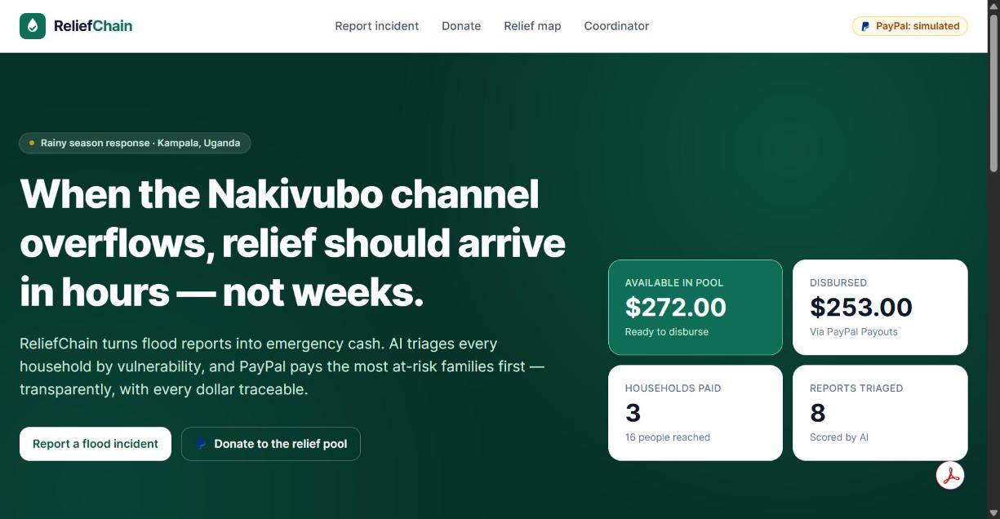
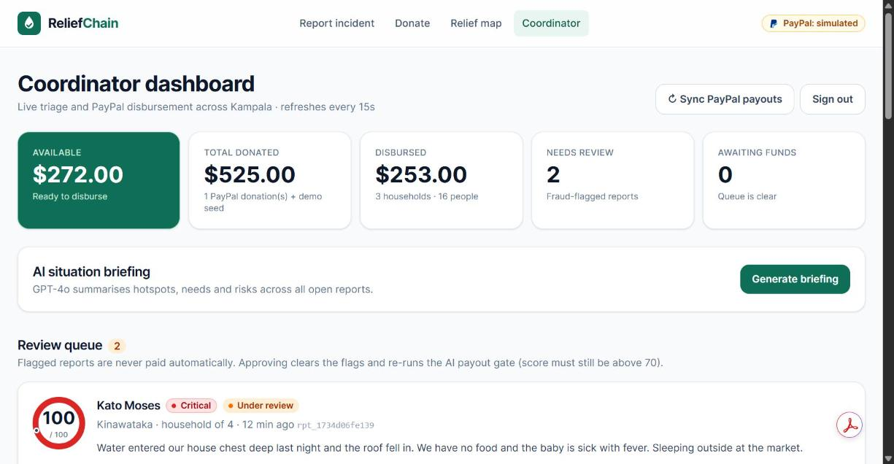
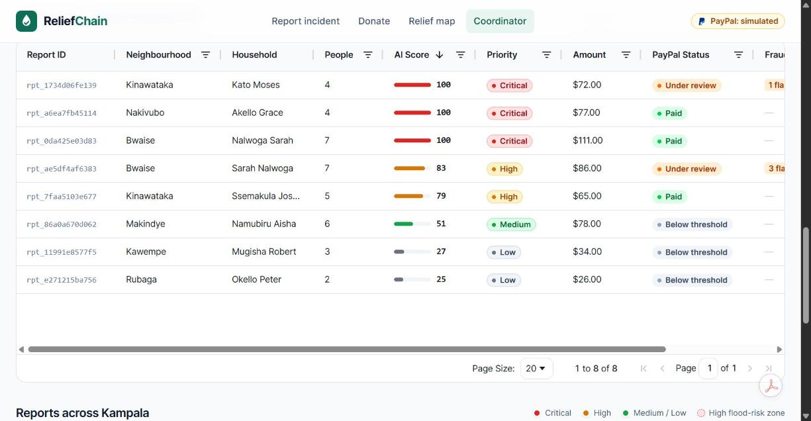
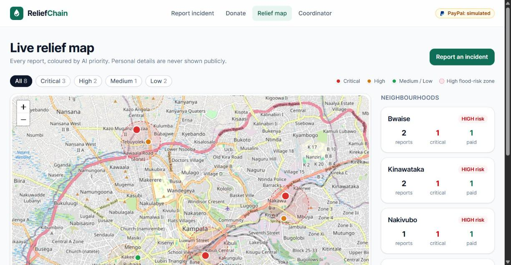

# ReliefChain

**AI-triaged emergency cash for flood-hit households in Kampala, Uganda, paid out through PayPal.**

When a flood hits, residents (or a community volunteer on their behalf) report what happened. GPT-4o scores each household's vulnerability from the report and photo, and screens it for fraud. The households most at risk are then paid automatically through **PayPal Payouts**. Donors anywhere fund the shared relief pool through **PayPal Checkout**.



> 🟡 **Sandbox only.** Every PayPal call goes to `api-m.sandbox.paypal.com`, and the UI shows a *PayPal sandbox · test mode* badge. No real money moves.

---

## 1. The problem: Kampala's relief coordination gap

Every rainy season, flash floods hit Kampala's low-lying informal settlements. **Bwaise**, **Kinawataka** and **Nakivubo** sit on the Lubigi and Nakivubo channel flood plains. Drains overflow within an hour of heavy rain, and families lose food stock, bedding, market goods and sometimes their homes.

[KampalAlert](https://github.com/Ray56monds/kampala-flood-sms) already solves the *warning* problem by sending flood alerts over SMS. Relief money is a different problem. It's coordinated over phone calls and paper lists. Nobody can say quickly who needs help most, and the most vulnerable people (elderly residents, mothers with infants, people with disabilities) are often the last to be counted.

**ReliefChain is the next layer.** It gives donors and coordinators an auditable pipeline from *report* to *cash in hand*: AI decides **who first**, and PayPal handles **how**.

## 2. How it works

```text
 ┌──────────────┐     ┌──────────────────────────────┐     ┌─────────────────────────┐
 │ 1. REPORT    │ ──▶ │ 2. AI TRIAGE                 │ ──▶ │ 3. PAYPAL PAYOUT        │
 │ phone form:  │     │ • records check: duplicates, │     │ score > 70              │
 │ household,   │     │   bursts (deterministic)     │     │ AND no fraud flags      │
 │ vulnerable   │     │ • GPT-4o: score 0-100,       │     │ AND pool can cover it   │
 │ members,     │     │   priority, amount, needs,   │     │ → Payouts API, status   │
 │ photo        │     │   fraud flags, photo check   │     │   polled until SUCCESS  │
 └──────────────┘     └──────────────────────────────┘     └─────────────────────────┘
                                   │ flagged / ≤ 70                     ▲
                                   ▼                                    │
                        coordinator reviews in the dashboard ───────────┘
        Donors ── PayPal Checkout (Orders v2) ──▶ relief pool ──▶ releases queued payouts, most vulnerable first
```

| Outcome | When | What happens |
|---|---|---|
| **PAID** | Score > 70, no flags, pool has funds | PayPal payout sent automatically |
| **AWAITING_FUNDS** | Eligible, but the pool is short | Queued; the next donation releases it, highest score first |
| **FLAGGED** | Any fraud flag (from the AI or the records check) | Never paid automatically; a coordinator approves or rejects it |
| **BELOW_THRESHOLD** | Score ≤ 70 | Recorded for partner follow-up |
| **PAYOUT_FAILED** | PayPal error, or the payout was returned | Reserved funds go back to the pool; can be retried |

## 3. Tech stack

| Layer | Technology |
|---|---|
| Frontend | React 19 + Vite, TailwindCSS v4, React Router |
| Data grid | **AG Grid** Community (reports table + PayPal transaction log) |
| Maps | Leaflet + react-leaflet, OpenStreetMap tiles |
| Backend | Node.js + Express |
| Database | Firebase Firestore (falls back to a local JSON store when there are no credentials) |
| AI | OpenAI **GPT-4o**: structured outputs and vision |
| Payments | **PayPal REST**: OAuth 2.0, Orders v2 (donations), Payouts v1 (disbursements) |
| Deployment | **Render** Blueprint (`render.yaml`) |
| API docs | **Postman** collection (`postman/`) |

## 4. PayPal and AI integration in depth

### AI: vulnerability triage ([server/services/aiService.js](server/services/aiService.js))

- **Strict JSON schema** (`response_format: json_schema, strict: true`). GPT-4o can only return a well-formed triage object, so a malformed reply can never get through the payout gate.
- **Vision:** the household's photo is sent alongside the text. The model reports a `photo_assessment` and can raise `photo_mismatch`.
- **Kampala context in the prompt:** neighbourhood flood risk (Bwaise, Kinawataka and Nakivubo are HIGH), household size, and a breakdown of vulnerable members.
- **Two-layer fraud screening:** deterministic checks on our own records (same PayPal email or same household within 14 days, bursts from one device) are combined with the model's judgement-based flags (`inconsistent_details`, `low_detail_report`, …). **The model cannot clear a records flag.**
- **Defensive sanitising:** score is clamped to 0–100, amount to $10–$150, priority to the enum.
- **Coordinator briefing:** a second GPT-4o call summarises hotspots, recommended actions and risks across all open reports.
- **Heuristic fallback:** with no API key, or if the API fails, a transparent rule-based scorer keeps the pipeline running. Results are labelled `source: "heuristic"`.

```js
const completion = await openai.chat.completions.create({
  model: 'gpt-4o',
  response_format: { type: 'json_schema', json_schema: TRIAGE_SCHEMA }, // strict
  messages: [
    { role: 'system', content: SYSTEM_PROMPT },
    { role: 'user', content: [
        { type: 'text', text: buildUserPrompt(report, context) },
        { type: 'image_url', image_url: { url: report.photo, detail: 'low' } },
    ] },
  ],
});
```

### PayPal ([server/services/paypalService.js](server/services/paypalService.js), [disbursementService.js](server/services/disbursementService.js))

Plain REST calls with no SDK, so every request is visible in the code:

- **OAuth 2.0 client credentials:** the token is cached until 60 s before it expires.
- **Orders v2:** `create-order` → buyer approves in the PayPal JS SDK → `capture-order`. The pool is credited with **the amount PayPal reports as captured**, never the amount the browser sent. Captures are **idempotent** per order ID.
- **Payouts v1:** one `EMAIL` item per household, `sender_item_id = reportId`, and a `PayPal-Request-Id` header so a retry can never pay twice.
- **Asynchronous settlement:** payouts start as `PENDING`. The server polls `GET /v1/payments/payouts/{batch_id}` every 2 minutes (or on *Sync PayPal payouts*) and settles the ledger:
  `SUCCESS`/`UNCLAIMED` → disbursed · `FAILED`/`RETURNED`/`BLOCKED` → funds go back to the pool.
- **Pool ledger:** funds are **reserved atomically** (in a Firestore transaction) before a payout is created, so concurrent payouts can't overdraw the pool.

```js
// Disbursement gate: AI decides, PayPal pays
if (report.fraudFlags.length) return hold('FLAGGED');
if (report.ai.vulnerability_score <= 70) return hold('BELOW_THRESHOLD');
if (!(await db.reserveFunds(amount))) return hold('AWAITING_FUNDS');
await createPayout({ reportId, amount, recipientEmail, neighbourhood }); // POST /v1/payments/payouts
```

### API endpoints

| Method | Path | Auth | Purpose |
|---|---|---|---|
| GET | `/api/health` | – | Shows which integrations are live |
| POST | `/api/reports` | – | Submit a report → triage → gated payout |
| GET | `/api/reports/public` | – | Anonymised feed for the map |
| GET | `/api/reports/:id/status` | – | Status lookup for the person who submitted |
| GET | `/api/reports` | admin | Full reports, with the gate decision |
| POST | `/api/reports/:id/review` | admin | `approve` (clears flags, re-runs the gate) / `reject` |
| POST | `/api/ai/score` | – | Dry-run AI triage |
| POST | `/api/ai/briefing` | admin | AI situation briefing |
| GET | `/api/paypal/config` · `/pool` | – | Client ID / mode · pool stats |
| POST | `/api/paypal/create-order` · `/capture-order` | – | Donations |
| POST | `/api/paypal/payout` | admin | Run the gate and pay out |
| POST | `/api/paypal/payout/:txId/refresh` · `/payouts/refresh` | admin | Sync payout status |
| GET | `/api/paypal/transactions` | admin | PayPal transaction log |

Admin requests send `x-admin-key: <ADMIN_API_KEY>`. The full collection is at [postman/ReliefChain.postman_collection.json](postman/ReliefChain.postman_collection.json).

## 5. Run it locally

Requires **Node 20+**.

```bash
git clone https://github.com/Ray56monds/reliefchain.git
cd reliefchain
npm run install:all          # root + server + client
cp .env.example .env         # optional — works without any keys (see below)
npm run dev                  # API on :3001, web app on http://localhost:5173
npm run seed                 # in a second terminal: 7 realistic Kampala reports
```

Open http://localhost:5173. The coordinator dashboard key is the `ADMIN_API_KEY` value (default `reliefchain-demo-admin`).

**Zero-config demo mode.** Each integration switches on when its keys are present:

| Missing | Fallback | Shown in the UI as |
|---|---|---|
| PayPal keys | Simulated orders and payouts | *PayPal: simulated* badge, `(sim)` tags |
| OpenAI key | Heuristic triage | *heuristic* on each AI result |
| Firebase keys | `server/.data/db.json`, pool seeded with $500 | `database: local` in `/api/health` |

### PayPal sandbox setup

1. Go to [developer.paypal.com](https://developer.paypal.com) → **Apps & Credentials** → **Sandbox** → *Create App*.
2. Copy the **Client ID** and **Secret** into `.env` as `PAYPAL_CLIENT_ID` / `PAYPAL_CLIENT_SECRET`. Keep `PAYPAL_MODE=sandbox`.
3. **Testing tools → Sandbox accounts:** use the *personal* account's email as the payout recipient on the report form (or set `VITE_DEMO_RECIPIENT_EMAIL` to prefill it).
4. Donate on `/donate` and log in with a sandbox **buyer** account in the PayPal popup.
5. Payouts must be enabled on the sandbox business account (they are by default for new sandbox apps).

### End-to-end sandbox test (≈ 3 minutes)

1. `/donate` → donate $50 with the sandbox buyer. The pool rises and the donation appears under *PayPal transactions*.
2. `/report` → a Bwaise household of 6 with 2 children and 1 elderly member: "water waist-deep, roof collapsed, no food". The result is CRITICAL and the payout is sent.
3. `/dashboard` → *Sync PayPal payouts*. The status moves from `PENDING` to `SUCCESS`. Log in to the sandbox personal account to see the money arrive.
4. Submit the same household again. It's FLAGGED (duplicate). Approve or reject it in the review queue.

## 6. Environment variables

See [.env.example](.env.example).

| Variable | Required | Description |
|---|---|---|
| `PAYPAL_CLIENT_ID` / `PAYPAL_CLIENT_SECRET` | for real PayPal | Sandbox REST app credentials |
| `PAYPAL_MODE` | | `sandbox` (default) or `live` |
| `OPENAI_API_KEY` | for GPT-4o | Otherwise heuristic triage is used |
| `OPENAI_MODEL` | | Default `gpt-4o` |
| `FIREBASE_PROJECT_ID` / `FIREBASE_CLIENT_EMAIL` / `FIREBASE_PRIVATE_KEY` | for Firestore | Service account; keep `\n` escapes in the key |
| `ADMIN_API_KEY` | **change in production** | Coordinator dashboard key |
| `CORS_ORIGIN` | | Comma-separated allowed origins, or `*` |
| `PAYOUT_SCORE_THRESHOLD` | | Default `70` |
| `MIN_PAYOUT_USD` / `MAX_PAYOUT_USD` | | Default `10` / `150` |
| `DEMO_SEED_POOL_USD` | | Starting pool in local mode, default `500` |
| `VITE_API_URL` | split deploys | Public API URL for the static site |
| `VITE_DEMO_RECIPIENT_EMAIL` | | Prefills the payout email on the report form |
| `PORT` | | API port, default `3001` |

### Deploy on Render

**New → Blueprint** → pick this repo. [render.yaml](render.yaml) creates `reliefchain-api` (Node web service) and `reliefchain-web` (static site).

- Fill in the secrets when prompted.
- Set `VITE_API_URL` on the static site to the API's public URL.
- Add Firestore credentials. Without them, data on Render's free tier resets whenever the service restarts.

*Single-service alternative:* run `npm run build && npm start`. Express serves `client/dist` itself.

## 7. Screenshots

| Coordinator dashboard | AG Grid reports table |
|---|---|
|  |  |

| Live relief map | |
|---|---|
|  | |

*Demo video: coming soon (3-minute walkthrough of report → AI triage → PayPal payout).*

## 8. What's next

- **Pilot in Bwaise** with LC1 chairpersons acting as verified field volunteers.
- **KCCA integration:** share anonymised triage data with Kampala Capital City Authority's disaster desk.
- **KampalAlert link:** pre-register flood-alert SMS subscribers so households are verified before a flood.
- **Luganda language support** for the report form and AI reasoning, plus voice reports for low-literacy users.
- **Mobile money payouts** (MTN MoMo / Airtel Money) alongside PayPal, for households without PayPal.
- **Donor transparency page:** a per-donation trail showing which neighbourhoods the money reached.

## 9. License

[MIT](LICENSE) © 2026 Ray56monds
